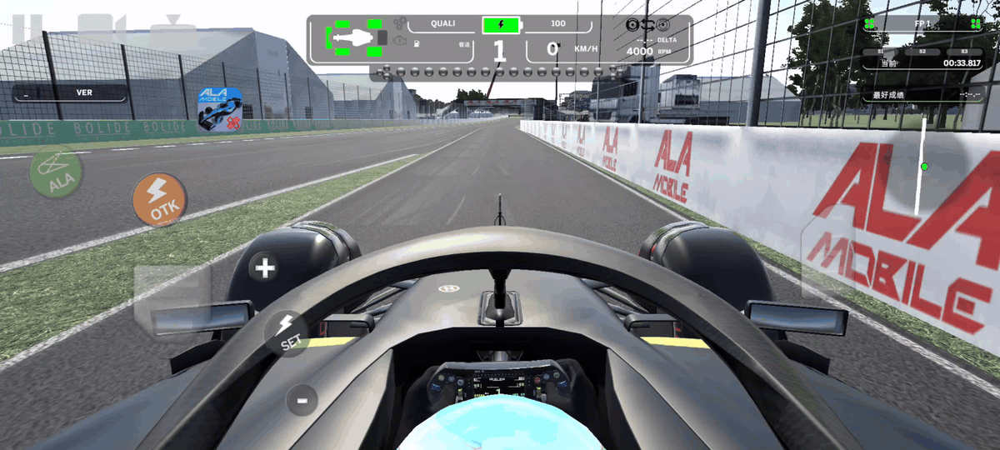
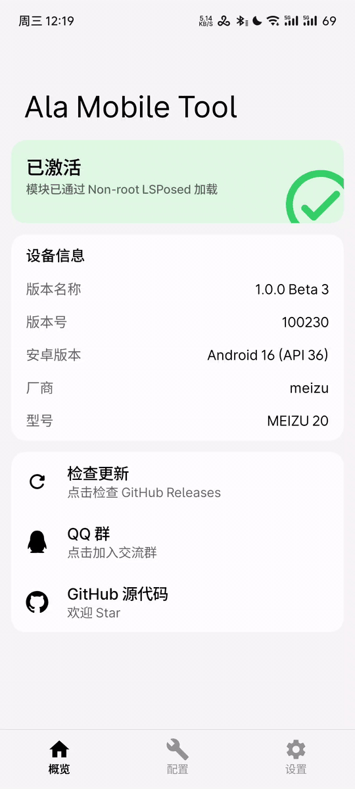

# Ala Mobile Tool

<p align="center">
  
  
  
  
</p>

<p align="center">
  <strong>Ala Mobile 的体验增强 LSPosed 模块</strong><br>
  线性踏板 · 原生 TC/ABS 调校 · 围场计时赛排行榜 · 音乐与声浪替换 · 内购解锁
</p>

---

> ⚠️ **免责声明**：本项目仅供 **个人学习、技术研究与逆向工程教学** 使用。它通过修改游戏运行时
> 行为（内存读写、函数钩子、输入注入）增强操控体验，**可能违反游戏服务条款并导致账号封禁**。
> 请自行承担全部风险，作者不承担任何直接或间接损失的责任。与游戏开发商、发行商无任何关联。

---

## 演示

| 单踏板 | 双踏板 |
|---|---|
|  |  |

**单踏板**：手指上下滑动，上半区油门、下半区刹车。**双踏板**：左右两指分别控制独立踏板。

| 布局编辑 | 模块设置界面 |
|---|---|
|  |  |

长按工具按钮进入编辑模式：拖拽移动、四角缩放、长按空白 2 秒重置。

---

## 功能

| 分类 | 能力 |
|---|---|
| **操控** | 线性踏板（关闭 / 单踏板 / 双踏板）· 自定义响应曲线（多点控制点）· 双踏板优先级仲裁（6 策略）· 方向反转 · 透明度 / 边框 / 圆角可调 |
| **驾驶辅助** | 原生 TC 档位（削减强度 + 介入时机）· 原生 ABS 档位（五档干预强度）· 最大制动压力 50–100% · 自动 DRS 与主动空力 · 自锁式超车按键 · 解除最大转向角度限制 |
| **实时反馈** | TC/ABS 介入指示灯（上缘弓形，25Hz 同频闪烁）· 抓地力反馈（六通道振感 + 下缘光斑，1/4 强度 = 最佳抓地力）· 路肩振感（颗粒率随车速） |
| **计时赛** | 禁止删除下一圈成绩（冲出限制只废本圈）· 有效圈自动识别（16 条 GP 赛道）· 圈速与车辆调教自动采集 |
| **围场** | 在线排行榜（积分总榜 + 分赛道圈速榜）· 通行证账号 · 圈速自动上传（断网本地暂存补传）· 车手主页 · 账号设置（头像 / 改名 / 屏蔽缺失记录）· 围场指南 |
| **其他** | 内购与 DLC 解锁 · 修复 DLC 更新卡加载 · 隐藏游戏原生油门 / 刹车 · 主菜单音乐替换 · V10 引擎声浪 · 日志一键导出 |

> 「围场」是本模块的在线计时赛服务。默认使用官方服务器，也可在设置页切换为自建服务端
> （见 [ala-mobile-paddock](https://github.com/TakotsuboChen/ala-mobile-paddock)）。

---

## 安装

### 前提

- Android 8.0 及以上，**arm64-v8a**
- 游戏：**Ala Mobile Pro 8.0.6 Fix 3**（`com.Takotsubo.AlamobileFormula`，versionCode 200150）
- 框架：**LSPosed**（Root）或 **NPatch 850**（非 Root）

> 官方原版包已停止支持，仅支持共存版（应用名 "Ala Mobile Pro"）。版本不匹配时模块
> **零 Hook 并循环提示更新**，游戏本身可正常运行、不会闪退。

### Root（LSPosed）

1. 从 [Releases](https://github.com/TakotsuboChen/ala-mobile-tool/releases) 下载 APK 并安装
2. 在 LSPosed 管理器中启用 **Ala Mobile Tool**
3. 作用域勾选 **Ala Mobile Pro**（`com.Takotsubo.AlamobileFormula`）
4. 打开模块 App，授予 **「所有文件访问」** 权限（必填，缺了模块无法正常工作）
5. 启动游戏，点击左上角工具按钮展开 Overlay
6. **登录围场**：模块的计时赛、排行榜与游戏内功能均需登录围场通行证

### 非 Root（NPatch）

1. 安装 [NPatch](https://github.com/nkbe/npatch) 850、共存版游戏与模块
2. 在 NPatch 中为 Ala Mobile 勾选 **Ala Mobile Tool** 作用域
3. 同样需授予模块「所有文件访问」权限
4. 启动游戏并登录围场

---

## 快速上手

首次启动按顺序通过三道门，全部通过后模块才会生效：

1. **用户协议** — 阅读并滚动到底，点击「同意」
2. **所有文件访问权限** — 跳系统设置授予，缺了模块无法正常工作
3. **登录围场** — 注册通行证（用户名 + 密码），按弹窗指令到 QQ 群发送校验消息完成建号

> ⚠️ 未登录围场时，模块在游戏内**不安装任何 Hook**——这是有意的门控，不是故障。

打开模块 App，底栏四页：

| 页面 | 内容 |
|---|---|
| **概览** | 激活状态、游戏与 NPatch 版本胶囊、设备信息、检查更新、日志导出 |
| **配置** | 四张入口卡片：原生特性控制 / Overlay 控件 / 响应曲线 / 杂项 |
| **围场** | 排行榜、车手主页、账号设置、围场指南 |
| **设置** | 更新通道、围场服务器、导出日志、用户协议 |

---

## 已知问题

- **手动换挡**：`DoGearShifting` Hook 曾导致起步失败，当前禁用，待重写
- **大奖赛 / 娱乐匹配**：围场页占位入口，服务端赛程功能待实现
- **弯道顿挫**：通常来自游戏内置刹车辅助，请在游戏设置中关闭；也可用模块的 ABS 干预强度与最大制动压力缓解
- **抓地力 / 路肩振感** 标注为实验性，手感仍在迭代

---

## 自行构建

需要 Android SDK（API 37）、NDK 26.1 与 JDK 17+。

```bash
./gradlew :app:assembleDebug     # 调试构建
./gradlew :app:assembleRelease   # 发布构建
./gradlew :app:lint              # 提交前必跑
```

Native 层位于 `native/`，仅编译 `arm64-v8a`。IL2CPP 偏移提取：

```bash
tools/run-il2cpp-dumper.sh
```

方法偏移的**单一事实源**是 `app/src/main/kotlin/tools/alamobile/mod/offsets/OffsetTable.kt`。

---

## 文档

| 文档 | 内容 |
|---|---|
| [TECHNICAL_ANALYSIS](docs/TECHNICAL_ANALYSIS.md) | 游戏引擎逆向分析（ABS / TC / 圈速 / 赛道） |
| [TRACK_IDENTIFICATION](docs/TRACK_IDENTIFICATION.md) | 16 条 GP 赛道对照表 |
| [docs/notes](docs/notes/) | 各子系统工程笔记与踩坑记录 |
| [docs/design](docs/design/) | 设计决策与跨仓契约 |

---

## 社区

- [GitHub Issues](https://github.com/TakotsuboChen/ala-mobile-tool/issues) — 反馈 bug 或提功能建议
- [QQ 群 757940708](https://qun.qq.com/universal-share/share?ac=1&authKey=V0nuKHg0u%2BZKVi/jgDReAiZSCQdbMb0yMwaOSV49gejQWRtdz%2BG4G6eQQgWyFOJB&busi_data=eyJncm91cENvZGUiOiI3NTc5NDA3MDgiLCJ0b2tlbiI6IjVzRjZTTWpLckJIRExvRTk3K0QzVzJGK2N4QURRM2RwRjJWNkw0L29wcG9oaHIyNXo5T1hLZ2FJVkZXZkhlMVAiLCJ1aW4iOiIxMjU5OTc2NTIwIn0=&data=x1JvsLJUAovAdpfNmLQpuTN_-yGbUrMfCJ1VSQqD-QbIzj9-ZLiRKNEHNbJXpokkPhx5cc-RG47HyWYUrPBtTA&svctype=4&tempid=h5_group_info) — 玩家交流与通行证校验
- 欢迎提交 Pull Request

---

## 许可证

[Apache License 2.0](LICENSE)。游戏名称、素材与商标版权归其各自所有者。
